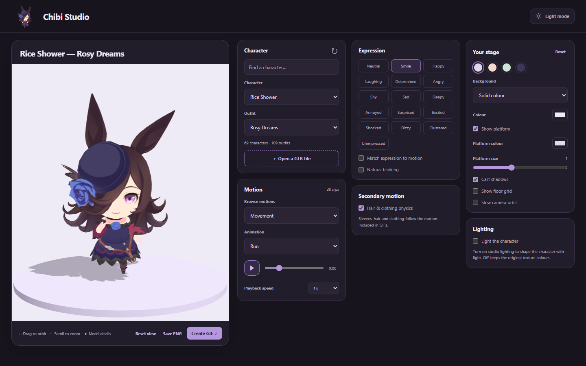

# Chibi Studio

A browser studio for Umamusume chibis. Pick a character and outfit, choose an
animation and expression, and save the result as a GIF or PNG.

[Open Chibi Studio](https://chibi.daftuyda.moe/) in your browser. No installation
is needed to use the hosted studio.



## Run

Requires **Python 3.10 or newer** and a browser with **WebGL 2** support.
From the project folder:

```sh
python viewer.py
```

Open [localhost:8084](http://localhost:8084). The included character library
loads automatically. The viewer uses Python's standard library and bundled
browser dependencies, so there is no package installation or frontend build
step to start it.

## Make something

- **Character and outfit:** browse 69 characters and 109 outfits, including
  alternate outfit titles. Search the library or open your own GLB file.
- **Motion and expression:** choose from 37–41 motions per outfit and 16
  expressions. Pause, scrub, change speed, match expressions to the motion,
  and enable natural blinking.
- **Secondary motion:** add movement to sleeves, hair and clothing using the
  exported cloth data. Agnes Tachyon's **Character pose 00 res01** is a good
  example of sleeve movement.
- **Stage:** choose a solid colour, gradient, image or transparent background.
  Toggle the platform, shadows and grid, and adjust the platform and lights.
  Drag to orbit, scroll to zoom, or enable a slow camera turn.
- **Export:** save a transparent PNG or a looping GIF. GIF settings include
  size, shape, frame rate, duration and a full camera turn. Your expression,
  physics and stage settings are included.
- **Appearance:** switch between light and dark mode. Wide screens show the
  controls beside the preview; smaller screens stack them below it. The
  transparent Rice Shower mascot runs with its own camera orbit—click to pause.

The interface theme and stage settings are remembered in your browser.
Reduced-motion preferences are respected. Character files and background
images you open are processed in the browser and are not uploaded.

## Character library

The library lives in **`models/`** inside this project and is about **1.1 GB**.
Each outfit has its own folder:

```text
models/
  1030/
    manifest.json    # Rice Shower — Rosy Dreams; names, motions and expressions
    model.glb        # Meshes, textures, rig, animations and embedded metadata
    physics.json     # Original cloth parameters used by the importer
  1030-40/
    ...              # Rice Shower — Vampire Makeover!
```

The browser loads outfits on demand. The models are self-contained and do
not need an installed copy of the game to view them.

Model binaries are configured for [Git LFS](https://git-lfs.com/) in
`.gitattributes`. When working from a Git clone, install Git LFS and fetch
the model files before starting the viewer:

```sh
git lfs install
git lfs pull
```

A missing library after cloning usually means the GLBs are still LFS pointer
files. `git lfs pull` retrieves the actual models. Manifests and cloth metadata
are ordinary JSON files.

To use a different library:

```sh
python viewer.py --models /path/to/models
```

`CHIBI_MODELS_DIR` also sets the library path; `--models` takes precedence.
For adding or refreshing models from an installed Global game, see
[Importing models](docs/importing-models.md).

## Server options

The default address is `127.0.0.1:8084`. To choose a network interface and port:

```sh
python viewer.py --host 0.0.0.0 --port 8084
```

The Python server needs `viewer.py`, `web/` and the complete `models/` library,
including the actual GLBs fetched by Git LFS. The server serves the interface,
the character catalog and the models.

For a public website, build a static version:

```sh
python build_static.py --output .local/site
```

The static site includes the full character catalog and models, with versioned
URLs for caching. It runs without Python on the host. Local-file processing
and GIF rendering happen in each visitor's browser. See [Hosting Chibi
Studio](docs/hosting.md) for Nginx, HTTPS, Cloudflare and release updates.

## Export and model limits

GIFs can be square, portrait or landscape at 256, 512 or 768 pixels and
10, 20 or 25 fps. Export one animation cycle or a selected duration, up to
20 seconds. You can cancel an export, and the preview is restored afterward.
GIF transparency has hard edges; PNG retains smooth transparent edges.

GLB imports must be self-contained glTF 2 files under 80 MB. External textures
or buffers and Draco, meshopt or KTX2 compression are not supported. Exported
metadata preserves outfit titles, motion groups, face controls and physics
when a character is opened directly from a file.

Clothing physics is a spring-bone approximation with sphere/capsule collisions
and loop warm-up. It does not reproduce the game's cloth engine exactly;
wind, branched/linked chains and some collider constraints are unsupported.
Physics is baked per selected clip, up to 30 seconds, and reused for playback,
scrubbing and GIF export.

## Development

```sh
python -m pip install -r requirements-dev.txt
python -m pytest tests/test_viewer.py tests/test_chibi_import.py tests/test_static_build.py -q
```

With the viewer running, the browser checks use an installed Chrome browser:

```sh
python tests/check_chibi_browser.py
python tests/check_chibi_studio.py
python tests/check_chibi_physics.py
python tests/check_chibi_library.py
```

Set `CHIBI_STUDIO_URL` to check a different address. Captures and reports go
under `.local/`. The checks cover the character library, animation and face
controls, GIF frames and transparency, cancellation, physics, and mobile use.

```text
viewer.py              HTTP server and character catalog
build_static.py        Build the public website for static hosting
deploy/                Nginx configuration and release publisher
web/                   Browser interface, renderer, physics and GIF encoder
models/                Included character library
tools/chibi_export/    Optional Global game importer
tests/                 Server, importer and browser checks
.local/                Ignored tools, configuration, caches and test output
```

## Sources and credits

- [UmaViewer](https://github.com/katboi01/UmaViewer) provides the model and
  animation loading used by the optional importer.
- [Three.js](https://github.com/mrdoob/three.js/tree/r180), version 0.180.0,
  renders the 3D characters and camera controls. Its
  [MIT license](web/vendor/three/LICENSE) is included with the library.
- [gifenc](https://github.com/mattdesl/gifenc), version 1.0.3, encodes GIFs in
  the browser. Its [MIT license](web/vendor/gifenc/LICENSE.md) is included.
- [BepInEx 5](https://github.com/BepInEx/BepInEx) runs the optional exporter
  inside a separately supplied UmaViewer Mono player.

Chibi Studio is an unofficial Umamusume project. The characters, models,
textures, animations and cloth data are third-party game content; the
software-library licenses above do not license those assets. Game databases,
player binaries and local configuration are kept outside the versioned files.
